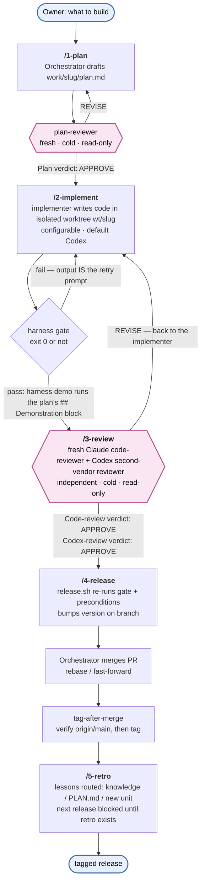
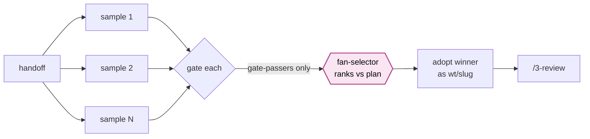

# agentic-coding

A small, opinionated framework for building software with AI agents — where **no agent is ever trusted to check its own work.**

One Claude Code session acts as the **Orchestrator**: it plans, dispatches, and drives the loop. Every stage that could go wrong is checked by a *different* agent — a fresh thread, cold context, often a different model — and by a deterministic shell gate that no agent can talk its way past. The human is the **Owner**: they set direction. The Orchestrator runs the release end to end: push, PR, merge and tag.

No custom runtime. No ceremony that doesn't catch a defect.

---

## The loop

```
/1-plan  →  /2-implement  →  /3-review  →  /4-release  →  /5-retro
```

Each stage produces an **artifact** (a plan, a diff, a release commit), and each artifact is handed to an independent checker before it advances. Feedback flows *backward* until the checker is satisfied; work only moves *forward* on an explicit verdict.



The five **`/slash`-command stages** are the loop. `{{Hexagons}}` are the **adversarial checkpoints** — an agent whose only job is to try to break the previous agent's work. Blue nodes mark the Owner and the completed release. Everything else is the Orchestrator driving the loop. In repo mode both reviewers must approve; in registry mode review uses only the code-reviewer, and release writes `pr.md` and stops before the Owner or the profile opens the PR. A plan can declare `Stacked on: <parent>` to build on an unmerged unit.

Trivial fixes (typos, one-liners, config tweaks) skip the loop — you just do them on a branch. The loop is for work with enough surface area to get wrong.

---

## Why the agents grill each other

The writer does not review its own work. Reviewers have read-only tools, so they report findings rather than fix them.

Each review and re-review runs in a fresh thread that sees only the diff and the plan. A reviewer that watched the code being written is anchored to its reasoning. Roles can use different models or vendors, so one model's blind spot is another's obvious bug.

`harness gate` must pass; no agent can overrule it. The gate catches mechanical defects, and reviewers catch what a green gate hides.

---

## Best-of-N implement (opt-in)

For high-value work units, `/2-implement` can run **N implementer samples, each in its own isolated worktree**, drop the ones that fail the gate, and have a fresh `fan-selector` agent pick the winner by plan-fit — another instance of the same principle: generate diversity, then filter it through an independent judge. (Dispatch is sequential, so N > 1 costs N× wall-clock, not just N× tokens.)



It's off by default (`implementer.fan: 1` — byte-for-byte the single-agent path). Set N > 1 only when the extra implementer tokens are worth it. It reduces per-run *variance*; it does **not** replace cross-model review.

---

## Using it in a shared repo

`harness register` keeps harness state in a home-directory state directory, so no harness files are committed to the repo. The `work-slim` profile offers four lanes:

- **Explore:** work in notebooks and write reports without the loop.
- **Ship:** pass the gate and a fresh review, then self-merge a PR.
- **Loop:** run the full loop through review for changes that could cost days to get wrong.
- **Promote:** open one PR from the integration branch to protected `main`, listing each change as `[reviewed]` or `[unreviewed]`.

Set `integration_branch` in `config.yaml` (for example, `dev`) to base unit worktrees and review diffs on that branch. Small PRs can then land there without waiting for protected-branch approval; Promote carries them to `main`.

---

## Design rules

1. **Writer never reviews** — enforced by fresh subagent threads with read-only tools, not by prose.
2. **The gate is deterministic** — agents don't argue with exit codes; failure output *is* the retry prompt.
3. **Implementation happens in worktrees** — never in the main checkout; `harness worktree` manages them.
4. **Artifacts flow, not transcripts** — reviewers see the diff and plan, never the implementation conversation.
5. **Release is a script** — `harness release` owns every precondition as an exit code; it never pushes and never touches `main`. Tagging happens only after the PR merges, and only if the merged commit *is* the release commit.
6. **Context is tiered** — hot (`CLAUDE.md` + `ARCHI.md` + `PLAN.md`, ~300 lines total), warm (active skill + profile), cold (`knowledge/`, loaded on citation, starts empty).
7. **Vendor names live in `config.yaml` only** — swap the implementer or any reviewer model by editing one line.

---

## Layout

**This repo (`harness/`)** — published with README.md and LICENSE.

```
harness/CONSTITUTION.md  the orchestrator's rules, imported by each project's CLAUDE.md (hot)
harness/AGENTS.md    the implementer's contract
harness/skills/      the loop as skills:
                       1-plan · 2-implement · 3-review · 4-release · 5-retro · init · compact · docs
                       (1-plan & 2-implement carry prompts/*.tpl)
harness/agents/      the checkers (installed into ~/.claude/agents/) (read-only, own models, cold context):
                       plan-reviewer · code-reviewer · fan-selector
harness/bin/harness  location-independent command dispatcher
harness/scripts/     the deterministic layer:
                       install.sh     link dispatcher, skills and agents into the home directory
                       register.sh    register a work repo: home-directory state, nothing committed
                       project.sh     print the project's state dir, mode or project root
                       lib/stack.sh   shared stack parent, fork point and review base (sourced)
                       lib/project.sh shared registry/repo-mode resolution (sourced, not a command)
                       gate.sh        stack-detecting pass/fail
                       worktree.sh    isolated-checkout lifecycle
                       agent-exec.sh  dispatch the implementer into a worktree
                       fan-exec.sh    best-of-N dispatch + winner adoption
                       codex-review.sh second-vendor (codex) code reviewer
                       demo.sh        run a plan's ## Demonstration block
                       archi-fresh.sh ARCHI.md freshness check
                       state.sh       derive a work unit's stage and next action
                       release.sh     preconditions, version/changelog, tag-after-merge
harness/examples/    opt-in gate hooks
harness/profiles/    software · machine-learning · database · work · work-slim — add slots, never override
harness/skeleton/    starting config.yaml, ARCHI.md, PLAN.md, VERSION and CHANGELOG.md
harness/tests/       smoke suite for the shell layer
```

**Per-project state** — at the project root in repo mode, or in the registry state dir:

- `CLAUDE.md` / `CLAUDE.local.md`: imports from `register`, or from `/init` in repo mode.
- `ARCHI.md`, `PLAN.md`, `config.yaml`: missing files copied by `/init` from `harness/skeleton/`; repo mode also gets `VERSION` / `CHANGELOG.md`.
- `work/` and `knowledge/`: from `register`, or created by the loop.
- `scripts/gate.d/`: optional project gate extensions, added by hand.

---

## Getting started

1. Clone the public harness into your home directory:
   ```sh
   git clone https://github.com/ChristopherHoward1/agentic-coding-template.git ~/agentic-coding-template
   ```
2. Run `~/agentic-coding-template/harness/bin/harness install` and keep `~/.local/bin` on PATH.
3. In a work repo, run `harness register [--subdir <path>]`, follow the printed `/add-dir` step, then run `/init` in Claude Code. State lives under `$(harness project)` with no committed harness files.
4. For a personal repo in repo mode, run `/init` directly. It seeds missing starting files, scans the codebase, generates `ARCHI.md`, sets the profile, and verifies the gate.
5. Start work: `/1-plan <what you want>`, then follow the loop.

## Requirements

- **Claude Code** — the Orchestrator and the reviewer subagents.
- **An implementer CLI** — default `codex`; set `implementer.command` in `config.yaml` to use anything else (including Claude Code itself).
- **`git`, `bash`**, and whatever your project's gate needs (`shellcheck`, `ruff`, `pytest`, `cargo`, `go`, …); declare hard prerequisites with `gate.required_tools`. The gate auto-detects the stacks present.
